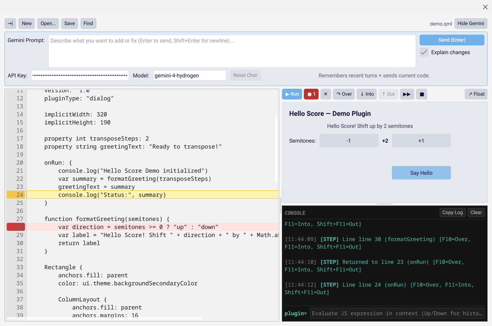

# Plugin Creator for MuseScore 4

A live QML editor, runner, debugger, and AI assistant for building and testing MuseScore 4 plugins directly inside MuseScore Studio.

## Features

- **Rapid Turnaround:** Write QML plugins and run them inside an embedded preview pane or a detachable floating window (`Float`), with code changes taking effect immediately.
- **Syntax-Aware Editing:** Editor supports syntax highlighting, find/replace, auto-indent, double-click to go to function definition, external change tracking, and more.
- **Multi-Breakpoint Debugger:** Click line numbers in the gutter (or press `F9`) to set breakpoints, then step through code (`Step Over`, `Step Into`, `Step Out`).
- **Console & Interactive REPL:** View `console.log`/`warn`/`error` output and inspect or modify live plugin properties and local variables while paused.
- **Gemini AI Assistant:** Optionally connect a Google Gemini API key to generate or fix QML code with current editor context and error logs automatically included.

## Screenshot

## Installation

1. Download the latest release `.zip` (or clone this repository).
2. Extract the `plugin-creator` folder into your MuseScore 4 Plugins directory (check **Edit → Preferences → Folders → Plugins** in MuseScore to confirm the exact path, typically `Documents/MuseScore4/Plugins`).
3. Open MuseScore 4, go to **Home → Plugins** (or **Plugins → Manage plugins...**), and enable **Plugin Creator**.

## Quick Start

1. Launch **Plugin Creator** from the **Plugins** menu.
2. Edit the starter template or open an existing `.qml` plugin (`Open...`).
3. Click **▶ Run** (or press `Ctrl+R`) to compile and execute your plugin.
4. Click any line number in the editor gutter to toggle a breakpoint.
5. While execution is paused at a breakpoint, you can single-step, evaluate expressions in the console, or continue execution.

### Keyboard Shortcuts

| Shortcut | Action |
| :--- | :--- |
| `Ctrl+O` | Open file |
| `Ctrl+S` | Save current file |
| `Ctrl+F` / `F3` | Find / Find Next |
| `Ctrl+/` | Toggle comment |
| `Tab` / `Shift+Tab` | Indent / Outdent |
| `Ctrl+R` | Run plugin |
| `F9` | Toggle breakpoint on current line |
| `F10` | Step Over (when paused) |
| `F11` / `Shift+F11` | Step Into / Step Out (when paused) |
| `Ctrl+Shift+W` | Close window |

## Credits & License

- Created by Marc Sabatella ([Outside Shore Music](https://outsideshore.com)).
- Developed with assistance from Google Gemini.
- Dedicated to the public domain under [CC0 1.0 Universal](LICENSE).
